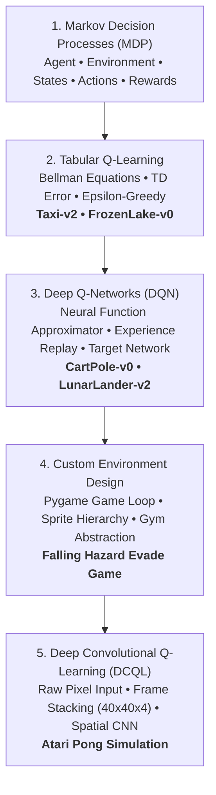

# ⚡ Reinforcement Learning Lab

<div align="center">


<br/>

**A state-of-the-art Reinforcement Learning monorepo covering Tabular Q-Learning (Bellman, TD-Learning), Deep Q-Networks (DQN, Experience Replay, Target Networks), Custom Pygame Simulation Environment Design, and Visual Deep Convolutional Q-Learning (DCQL).**  
Developed by **[Raşit Tekin](https://github.com/Rasittekin18)**.

[Theoretical Handbook](./docs/theoretical_foundations.md) • [Module Index](#-monorepo-modules) • [Installation & Usage](#-installation--quickstart) • [Mathematical Overview](#-mathematical-foundations) • [Author](#-author)

</div>

---

## 📌 Overview

This repository provides an end-to-end laboratory exploring the entire progression of Reinforcement Learning:
* **Tabular Foundations:** Bellman optimality equations, Temporal Difference error, and discrete Markov Decision Processes (MDP).
* **Deep Function Approximation (DQN):** Combating the curse of dimensionality through Neural Networks, Experience Replay memories, and Dual-Network target stabilization.
* **Custom Environment Architecture:** Building custom 2D simulation engines from scratch using Pygame with object-oriented Gym interfaces.
* **Perceptual Reinforcement Learning (DCQL):** Visual learning directly from raw screen pixels using Frame Stacking and Convolutional Neural Networks (CNN).

---

## 🧭 System Progression Architecture



---

## 📂 Monorepo Modules

| # | Module | Scope & Focus | Architectures & Benchmarks | Directory |
| :-: | :--- | :--- | :--- | :-: |
| **01** | **Tabular Q-Learning** | Discrete state-action matrices, Temporal Difference updates, convergence under stochastic dynamics. | OpenAI Gym `Taxi-v2/v3`, `FrozenLake-v0/v1` | [`/01-tabular-q-learning`](./01-tabular-q-learning) |
| **02** | **Deep Q-Networks (DQN)** | Continuous state spaces, correlation breaking via Experience Replay, moving target solution. | OpenAI Gym `CartPole-v0/v1`, `LunarLander-v2` | [`/02-deep-q-networks-dqn`](./02-deep-q-networks-dqn) |
| **03** | **Custom Environment Design** | Pygame game loops, physics & collision detection, Gym-compliant RL interface design. | Custom 2D Falling Obstacle Evade Game | [`/03-custom-environment-design`](./03-custom-environment-design) |
| **04** | **Deep Convolutional Q-Learning** | Vision-based reinforcement learning from raw video streams, 4-frame stacking, spatial CNN. | Atari Pong 2D Simulation (`DCQL`) | [`/04-deep-convolutional-q-learning`](./04-deep-convolutional-q-learning) |
| **DOCS**| **Theoretical Handbook** | Comprehensive technical guide covering mathematical formulations, proofs, and interview Q&A. | Bellman, MDP, Experience Replay, CNN Vision | [`/docs/theoretical_foundations.md`](./docs/theoretical_foundations.md) |

---

## 📐 Mathematical Foundations

### 1. Bellman Optimality Equation
$$Q(s, a) \leftarrow Q(s, a) + \alpha \left[ R_{t+1} + \gamma \max_{a'} Q(s', a') - Q(s, a) \right]$$

### 2. Deep Q-Network Loss Function
$$\mathcal{L}(\theta) = \mathbb{E}_{(s, a, r, s') \sim \mathcal{D}} \left[ \left( r + \gamma \max_{a'} Q(s', a'; \theta^-) - Q(s, a; \theta) \right)^2 \right]$$

### 3. Adaptive $\epsilon$-Greedy Policy
$$\pi(a|s) = \begin{cases} \text{Random Uniform}(A), & \text{with probability } \epsilon \\ \arg\max_a Q(s, a), & \text{with probability } 1 - \epsilon \end{cases}$$
$$\epsilon \leftarrow \max(\epsilon_{min}, \epsilon \cdot \epsilon_{decay})$$

---

## 🚀 Installation & Quickstart

### 1. Clone the Repository
```bash
git clone https://github.com/Rasittekin18/reinforcement-learning-lab.git
cd reinforcement-learning-lab
```

### 2. Set Up Virtual Environment
```bash
# Windows
python -m venv venv
venv\Scripts\activate

# Linux / macOS
python3 -m venv venv
source venv/bin/activate
```

### 3. Install Dependencies
```bash
pip install -r requirements.txt
```

### 4. Run Any Module
```bash
# Run Tabular Q-Learning Taxi
python 01-tabular-q-learning/gym_taxi_qlearning.py

# Run CartPole DQN
python 02-deep-q-networks-dqn/cartpole_dqn.py

# Run Custom Pygame Environment Evade Game
python 03-custom-environment-design/pygame_custom_rl_game.py

# Run Visual Deep Convolutional Q-Learning Pong
python 04-deep-convolutional-q-learning/dcql_train.py
```

---

## 🛠️ Tech Stack & Tools

* **Core RL & Frameworks:** OpenAI Gym / Gymnasium, TensorFlow, Keras
* **Simulation & Graphics:** Pygame, Scikit-Image
* **Scientific Computing:** NumPy, SciPy
* **Data Visualization:** Matplotlib

---

## 👨‍💻 Author

**Raşit Tekin**  
*AI & Machine Learning Engineer | Electronics Engineer*  
* GitHub: [@Rasittekin18](https://github.com/Rasittekin18)  
* Website: [rasittekin.com](https://www.rasittekin.com/)  
* LinkedIn: [linkedin.com/in/rasittekin](https://linkedin.com/in/rasittekin)  
* Email: [rasittekin18@gmail.com](mailto:rasittekin18@gmail.com)  

---

## 📄 License

This repository is distributed under the **MIT License**.
